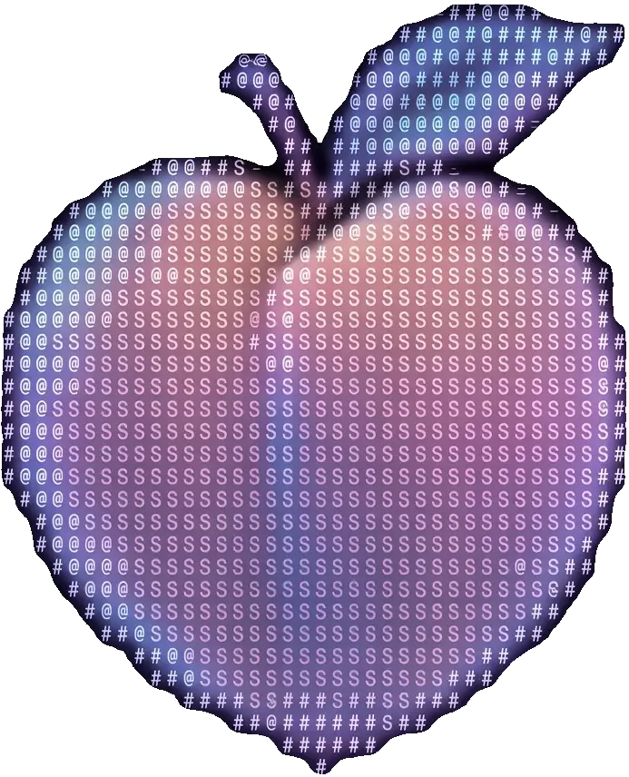

<div align="center">
  

  # PeachUI

  **Copy-ready React components for tools and agents.**

  [](LICENSE)
  [](https://react.dev)
  [](https://tailwindcss.com)
  [](https://nextjs.org)

  [Live catalog](https://peach-ui-plum.vercel.app/) · [GitHub](https://github.com/LuanTTran/peachUI) · [Browse the catalog](#whats-inside)
</div>

---

## What is PeachUI?

PeachUI is a component library you **copy, not install**. Every component ships as a readable TypeScript file you paste into your own codebase. Then it's yours to read, modify, and own.

- **No package to install.** No dependency tree, no version drift, no supply-chain surface. The code lives in your repo.
- **Built for the agent era.** Alongside the usual forms and overlays, PeachUI ships primitives and blocks for AI products: agent composers, thinking states, streaming text, tool approvals, run traces.
- **Agent-friendly docs.** Components are single-file, token-driven, and documented so both humans and coding agents can pick them up without reverse-engineering a design system.

The trade-off vs. an npm library: you own maintenance of what you copy. In return you get full control. No waiting on upstream releases, no fighting a theme API to change a border radius.

## What's inside

Four tiers, from smallest to largest:

| Tier | What it is | Examples |
| --- | --- | --- |
| **Atoms** | Single-purpose controls | Button, Input, Select, Tooltip, Tabs, Date picker |
| **Primitives** | Composed product patterns | Agent composer, Data grid, Kanban column, Streaming text, Timeline feed |
| **Blocks** | Full-featured sections | Agent chat, Kanban board, Settings, Sidebar, Review queue |
| **Templates** | Whole product screens | Coding agent IDE, Agent ops console, Inbox triage, Command center |

Every atom, primitive, and block has a live demo and copy-ready source on its catalog page. Templates are reference implementations that show how the pieces fit into a real app shell.

## Quick start

### Run the catalog locally

```bash
bun install
bun dev
```

Open [http://localhost:3000](http://localhost:3000) to browse every component, toggle light/dark, and copy source. The component index lives at `/library`.

> Requires [Bun](https://bun.sh) 1.4+. `npm`/`pnpm` work too. The scripts are standard `next` commands.

### Use a component in your app

Requirements: **React 19**, **Tailwind CSS 4**, **TypeScript**.

1. **Copy the design tokens.** Components are styled entirely through CSS variables, and won't look right without them:
   - [`app/globals.css`](app/globals.css) — color, shadow, focus, and theme tokens (light + `.dark`)
   - [`app/typography.css`](app/typography.css) — the type scale (`text-body-medium`, `text-caption-1-semibold`, …)

2. **Copy the utility helpers** from [`lib/utils.ts`](lib/utils.ts): `cn`/`cx` (clsx + tailwind-merge, extended for the PeachUI type scale) and `sortCx`. They assume the `clsx` and `tailwind-merge` packages.

3. **Copy the component file** from [`components/`](components/), e.g. `components/atoms/button.tsx`. Fix the `@/lib/utils` import to match your alias.

4. **Install the component's deps.** Most components only need the packages above. Some use headless, animation, or chart libraries. Each catalog page lists them, and so does the registry:

   | Dep | Used by |
   | --- | --- |
   | `react-aria-components` | Checkbox, Radio, Select, Slider, Switch, Tabs, Tooltip, Table, Dropdown, Input, Textarea, Date picker |
   | `motion` | Notifications, agent log, pickers, anything animated |
   | `@internationalized/date` | Date picker, Meeting scheduler |
   | `recharts` | Chart cards (revenue, orders) |
   | `@dnd-kit/*` | Kanban board, sortable lists |
   | `reicon-react`, `@lucasmarkes/hairline` | Icon set, hairline illustrations |
   | `border-beam` | **Not an npm package.** Copy the [`components/border-beam/`](components/border-beam/) folder (animated borders on Prompt bar, Agent composer) |

5. **Set up theming** (optional but recommended), see below.

## Theming

PeachUI uses class-based dark mode: add `.dark` to `<html>` and every token flips. Preferences persist under the `peach-ui-theme` localStorage key.

To avoid a flash of the wrong theme, run this before hydration. This is the exact snippet from [`app/layout.tsx`](app/layout.tsx):

```html
<script>
  (function(){try{var t=localStorage.getItem("peach-ui-theme");document.documentElement.classList.toggle("dark",t==="dark");}catch(e){}})();
</script>
```

See [`components/primitives/theme-toggle.tsx`](components/primitives/theme-toggle.tsx) for a ready-made toggle that writes the key and emits a change event the rest of the app can listen to.

## Repository layout

```text
app/
  (docs)/            # The catalog site: home, /library index, per-component doc pages
  (templates)/       # Routes that mount full-screen template demos
  globals.css        # Design tokens + base styles (light and .dark)
  typography.css     # Semantic type scale
components/
  atoms/             # Tier 1 — single-purpose controls (copy-ready)
  primitives/        # Tier 2 — product patterns (copy-ready)
  blocks/            # Tier 3 — composed sections (copy-ready)
  border-beam/       # Shared animated-border dep copied alongside components that use it
  lib/               # Shared helpers components import (motion presets, menu styles)
  types/             # Shared TypeScript types
  data/              # Shipped defaults + demo data
  catalog/           # Demo wrappers shown on doc pages (not shipped)
  showroom/          # Doc-page chrome (preview, source panel; not shipped)
packages/
  templates/         # Tier 4 — full product screens (reference, not registry-copyable)
lib/
  utils.ts           # cn / cx / sortCx — required by every component
  catalog/           # Registry: metadata + per-component deps
  templates.ts       # Template metadata
docs/                # The product north star (PRD.md)
public/font/         # Source Sans 3 (OFL), self-hosted
sample/              # Reference material, gitignored — never imported from production code
```

## For coding agents

PeachUI is designed to be legible to AI tooling:

- **Single-file components.** What you copy is what you read. No hidden sub-imports beyond `lib/utils`, the shared helpers in `components/lib|types|data|border-beam`, and listed npm deps.
- **Token-only styling.** No hard-coded hex in components. An agent can re-theme by editing variables instead of hunting through classNames.
- **Structured metadata.** [`lib/catalog/registry.tsx`](lib/catalog/registry.tsx) maps every component to its source path, npm dependencies, and category: a machine-readable manifest of the whole library.
- **A written north star.** [`docs/PRD.md`](docs/PRD.md) covers positioning, tokens, taxonomy, and the quality bar — useful context for an agent making changes.

## Contributing

Contributions are welcome. See [CONTRIBUTING.md](CONTRIBUTING.md) for the workflow: how to add a component, register it in the catalog, and the quality bar every PR is held to.

## Fonts

The UI face is **Source Sans 3** (SIL Open Font License), self-hosted from `public/font/` and safe to redistribute. The code/mono stack falls back to system fonts. Swap in your own face by redefining `--font-peachy-sans` in `globals.css`.

## License

[MIT](LICENSE). Copy anything, keep it, ship it.

## Acknowledgments

Built on [react-aria-components](https://react-aria.adobe.com), [Tailwind CSS 4](https://tailwindcss.com), [Motion](https://motion.dev), [dnd-kit](https://dndkit.com), [Recharts](https://recharts.org), and [@lucasmarkes/hairline](https://github.com/lucasmarkes/hairline).
